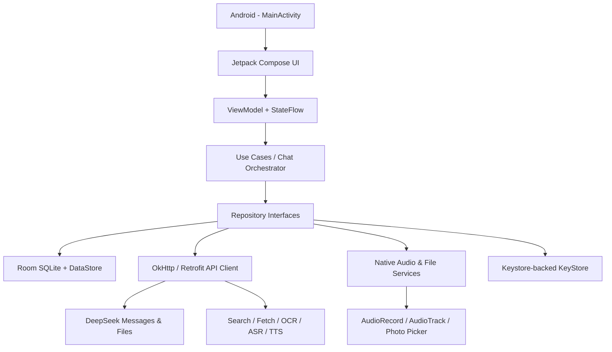

# DeepSeek Android 原生 App 设计文档（V1.1）

> **文档类型：** 产品需求文档（PRD）+ Android 原生技术设计（TDD）+ API 契约 + 验收计划  
> **状态：** 可供开发启动的基线设计；涉及正式 API 请求、语音/文件细节以官方文档和联调结果为准  
> **版本日期：** 2026-11-17  
> **目标交付：** 安装包（APK/AAB）、完整源码、测试报告、发布说明  
> **交互参考基线：** [deepseek-ai/chat-demo](https://github.com/deepseek-ai/chat-demo)（MIT；只参考，不直接移植 Web 框架）  
> **修订说明：** V1.1 废止 React + Capacitor + WebView 方案；统一采用 Kotlin + Jetpack Compose 原生开发；App 图标参考官方 Web Demo。  
> **API 基线：** [DeepSeek 全家桶应用 API 公告](https://api-docs.deepseek.com/zh-cn/news/news261113/) 与 [构建 Chatbot](https://api-docs.deepseek.com/zh-cn/guides/build_a_chatbot/)

---

## 1. 项目目标与决策

### 1.1 目标

开发**真正的 Android 原生应用**：所有主页面、聊天列表、文本输入、消息渲染、设置和历史会话均使用 **Kotlin + Jetpack Compose**，不用 React、Capacitor、H5 容器或 WebView 包装整个界面。功能与交互尽量对齐 DeepSeek 官方 `chat-demo` 和 DeepSeek App。

第一版必须交付可安装 APK/AAB，包含**DeepSeek ASR 语音输入**和 TTS 朗读；基于 DeepSeek 官方全家桶应用 API 完成聊天、深度思考、联网搜索、链接阅读、文件/图片、内容安全、ASR/TTS、OCR，以及独立 Search/Fetch 能力接入和联调。

**官方 Demo 的角色：**参考其页面交互、工具事件、会话分支、数据语义、错误边界、历史 ZIP 格式和视觉标识；源代码是 TypeScript/React，不能作为 Kotlin 原生组件原封不动复用。必须按许可要求保留所参考/复用代码的版权与许可说明。

“完整对接”的定义是：所有上述能力在 Android 客户端存在明确入口或由聊天链路自动触发，接口层有可复用实现、统一错误处理和真机验收。接口可用不等于官方 App 的账号、免费额度和历史实时同步可用。

### 1.2 V1 边界

| 维度 | V1.1 决策 | 原因 |
|---|---|---|
| 开发语言 | **Kotlin**；Gradle Kotlin DSL | Android 原生开发 |
| UI 框架 | **Jetpack Compose + Material 3** | 高一致性、可维护性与原生体验 |
| 页面承载 | `Activity` + Compose Navigation + 原生组件 | **禁止** Capacitor / React Native / Flutter / WebView 主页面 |
| 主聊天协议 | **DeepSeek Messages API** `/anthropic/v1/messages` | 对齐官方 Demo 的消息块、引用和 SSE 语义 |
| API 网络层 | **OkHttp + Retrofit + Kotlin Coroutines/Flow** | POST SSE、文件上传与 API 错误处理分离 |
| 数据层 | **Room(SQLite)** + **DataStore** + app-private 附件目录 | 进程重启可靠、迁移透明 |
| API Key | **Android Keystore** 加密后本地持久化，用户自行配置（BYOK） | 不能在 APK 中内置共享密钥 |
| 语音 | **AudioRecord → PCM/WAV → 官方 ASR → 编辑后发送** | V1 必做，使用官方识别服务 |
| 朗读 | **DeepSeek TTS → AudioTrack** | V1 必做，设备音频焦点管理 |
| 头像/图标 | **以 DeepSeek 网页版 Demo 使用的图标为视觉目标** | App 启动图标、启动页统一 |
| 模型 | `deepseek-flash`；可通过 `/models` 验证 | 官方全家桶能力按该模型设计 |
| 不在 V1 | 官方账户同步、实时逐字 ASR、自建模型、离线本地推理 | 非公开 API 能力或非首版需求 |

**版本建议：**首版最低 `minSdk=26`（最终按依赖验证）；`targetSdk` 取发布时 Google Play 要求的现行版本，不将某个未来值写死在本文档中。

### 1.3 品牌、界面与官方服务的边界

- 你指定的 **DeepSeek 官方网页版 Demo 图标**，作为 Launcher、应用列表、启动页的目标视觉资源；不是让开发者重新画一个“类似鲸鱼”图标。
- **已核对仓库 `main` 的完整文件树**：当前 `chat-demo` 仓库没有单独的 PNG/SVG/ICO 资源，`src/index.html` 也未声明 favicon。因此不能声称从该仓库直接提取到了“官方 App 图标”。ICON-01 资源任务为：核对在线 Demo 的实际网页图标或官方发布的对应品牌资源，记录准确来源和文件哈希，提取正式原图后再生成 Android 密度资源。
- 若在线 Demo 没有独立 favicon，则以**用户确认的 DeepSeek 官方视觉标识**作为替代来源；在确认之前，开发仓库可使用占位图标，但**发行版不得以占位图标交付**。不以第三方重绘图片冒充官方原图。
- **图标许可与软件 MIT 许可不同。** 内部测试可以按指定视觉做原型，公开上架前应核验商标与标识使用授权、应用名称以及是否存在官方身份混淆。
- 全家桶 API 不代表获得官方 DeepSeek 账号、历史数据实时同步或免费额度；BYOK 费用由用户自己的 API 账户承担。

## 2. 功能范围与优先级

### 2.1 V1 功能矩阵

| ID | 功能 | 优先级 | 主要接口 / 模块 | 用户体验与完成标准 |
|---|---|---|---|---|
| F01 | API Key 配置与验证 | P0 | `GET /models` | 填写、测试、保存、删除密钥；鉴权错误清晰 |
| F02 | 新建及多轮对话 | P0 | Messages | 发送、流式回答、停止生成、失败重试 |
| F03 | 深度思考开关 | P0 | `thinking.type` | 思考区实时更新、展开/折叠 |
| F04 | 联网搜索 | P0 | `deepseek_web_search` | 搜索状态、结果卡片、引用来源可打开 |
| F05 | 深度思考搜索 | P0 | thinking + web search | 多步工具过程呈现，引用与正文关联 |
| F06 | 阅读链接 | P0 | `deepseek_read_url` | 输入 URL 可触发阅读，展示抓取状态 |
| F07 | 图片上传与理解 | P0 | Files + Messages | 相册/相机选择、预览、提问 |
| F08 | 文档上传与理解 | P0 | Files + Messages | PDF/Office/表格/文本按格式处理，上传进度 |
| F09 | 会话历史与分支 | P0 | Room / 原生 Repository | 列表、重命名、删除、编辑、重新生成、切换版本 |
| F10 | 自动标题 | P0 | `title.enabled` | 第一轮生成标题，手动改名不被覆盖 |
| F11 | 语音输入 | **P0** | `POST /v1/tools/asr` | 录音、波形/计时、停止、转写、编辑再发送 |
| F12 | 语音朗读 | P0 | `POST /v1/tools/tts` | 朗读/停止、两种音色、后台/来电处理中断 |
| F13 | 内容安全处理 | P0 | `safety_check.high` | 收到拒答标志，隐藏已经暂显的风险文本 |
| F14 | OCR 提取文本 | P1 | `POST /v1/tools/ocr` | 附件操作入口“提取文字”，预览/复制结果 |
| F15 | 独立 Search / Fetch | P1 | `/v1/tools/search`、Fetch | 服务层完整封装、调试测试；用户主要使用模型内置搜索 |
| F16 | 历史记录导入导出 | P1 | 官方 ZIP 归档实现 | 导入校验、替换确认、导出备份 |
| F17 | 中英文、主题、设置 | P1 | Compose / DataStore | 深浅主题、语言、音色、隐私与数据清理 |

**P0 = APK 不可缺少；P1 = V1 发布目标但可以在功能冻结末期完成。** 若要求“全部官方独立能力在 V1 发布”，F14/F15 仍须通过 API 联调和验收，不得省略。

### 2.2 交互验收原则

1. 用户能不离开聊天页完成普通对话、搜索、文件输入与语音输入。
2. 每一次操作具有清晰状态：待输入、上传中、录音中、转写中、生成中、已结束、失败。
3. 网络/进程异常不应导致已保存的历史数据或用户未发送内容消失。
4. UI 不根据“某接口已经返回 200”就判断整次请求成功；须按各协议终止帧、业务 `error` 和安全拒答标志确认。
5. 独立 Search / Fetch 作为基础服务提供者，由开发测试页或诊断用例覆盖；用户的普通搜索优先让模型自行调用 `deepseek_web_search`，避免不必要的重复收费。

## 3. 页面与交互设计

### 3.1 信息架构

```text
App 启动
├── 首次配置 API Key（可跳过，聊天时再提示）
└── 聊天主页
    ├── 左侧抽屉：会话搜索 / 历史记录 / 新建聊天
    ├── 主聊天内容：消息 / 思考 / 联网过程 / 来源 / 附件
    ├── 底部输入区：文本 / 附件 / 语音 / 深度思考 / 联网
    └── 设置：API Key / 主题 / 语言 / 音色 / 数据管理 / 关于
```

### 3.2 首页（未进入对话）

- 使用 `Scaffold`、`ModalNavigationDrawer`、`LazyColumn`、`BasicTextField` 等 **Compose 原生组件**实现，不嵌入网页。
- 顶部：抽屉按钮、新建会话按钮；不放多级导航。
- 中部：简洁欢迎文案，保持官方 Demo 的视觉密度。
- 底部：输入框；附件按钮、**麦克风按钮**、深度思考开关、联网搜索开关、发送按钮。
- 软键盘：使用 `WindowInsets.ime` / `imePadding` 进行原生适配，输入框保持可见；防止双重顶起和列表跳动。

### 3.3 聊天详情页

- 消息流：用户消息靠右、模型消息靠左；支持长按复制、编辑提问、重新生成、切换分支。
- 回答体：思考块可折叠，搜索任务带进度，链接阅读附来源，Markdown/公式/代码块正常渲染。
- 来源：渲染 `citations` 与搜索结果，点击外部链接时使用 Android 外部浏览器/安全 Custom Tabs。
- 切换会话：以会话 ID 保存 `LazyListState` 的首项消息 ID/偏移和草稿；返回时恢复，生成任务独立于 Composable 生命周期，不应串流至当前会话。
- 流式渲染节流：消息增量合并后刷新视图，默认跟随末尾；用户主动上滑后停止自动追尾。

### 3.4 语音输入（V1 必做）

**交互：** 点击麦克风 → 弹出录音面板 → 计时/音量波形 → 点击完成 → 调用 DeepSeek ASR → 将识别文字填回输入框 → 用户编辑 → 点击发送。默认**不自动发送**，防止语音识别错误造成误提问或产生不必要的费用。

| 状态 | 页面表现 | 允许操作 |
|---|---|---|
| `idle` | 麦克风图标 | 开始录音 |
| `permission_required` | 系统授权提示 | 授权 / 取消 |
| `recording` | 时长、实时音量、停止/取消 | 完成、放弃 |
| `processing` | “正在识别语音…” | 取消请求；保留原草稿 |
| `recognized` | 转写文本回填输入框 | 编辑、删除、发送、重新录 |
| `error` | 错误文案 + 重试入口 | 重试上传 / 重新录音 |

**约束：** 官方 ASR 使用 `POST /v1/tools/asr`、`multipart/form-data` 的 `file` 字段，支持 16-bit PCM WAV 或 Ogg Opus；单次最长 **120 秒**、最大 **8 MiB**，自动识别语种，不提供实时识别结果。优先生成 **16 kHz、单声道、16-bit PCM WAV**；到达上限自动停止并提示。不得将 Android 系统语音识别偷偷替换为默认路径。

**原生实现：** 使用 Android `AudioRecord` 采集 PCM（优先 16kHz / mono / 16-bit），必要时按真实设备采样率重采样，按 WAV 规范写头；使用 `RECORD_AUDIO` 运行时授权，`AudioManager` 监听来电和音频焦点。上传通过 OkHttp multipart，不调用 Android 系统语音识别代替 DeepSeek ASR。后台、权限撤销、流程退出须停止并释放资源。权限被拒仍可键盘输入。

**性能与隐私：** 不持久化原始语音作为默认行为；转写失败时可临时保留本次 WAV 用于用户主动重试，离开流程后清理。明示语音内容将发送至 DeepSeek 接口进行识别。

### 3.5 回答朗读（V1）

- 用户点击回答下方“朗读”触发 DeepSeek TTS；再次点击停止。
- 默认使用整段 `POST /v1/tools/tts`，参数 `text`、`voice_id`（`stella` / `tide`）、`format=pcm`、`filter_markdown=true`。
- 原生 `AudioTrack(MODE_STREAM)` 播放 24 kHz、16-bit、单声道 PCM；`AudioFocusRequest` 管理音频焦点。单次输入文本不超过 10,000 个计费字符；长答案分段并保留连续播放状态。
- WebSocket 流式 TTS 可保留接口扩展，但 V1 不强制实现“边生成边读”；避免与聊天流、音频重排耦合。
- 同时最多朗读一条消息；切换语音、退出会话、播放失败或音频焦点丢失时正确停止。

### 3.6 附件与 OCR

- `+` 菜单：照片、拍照、文件。
- 选择文件后显示名称、体积、上传状态；禁止超限文件发送，允许移除与重试。
- 图片直接用于视觉理解；PDF/Word/PPT 可选择或自动判定文本解析、图文混排解析；普通文本、表格与电子书走 `user_data`。
- OCR 作为附件的“提取文字”辅助动作：调用独立 `/v1/tools/ocr`，展示识别文字、页码及复制入口。**OCR 不等于对话文件上传；不应因为普通聊天已上传文档而自动额外调用 OCR。**

## 4. Android 原生系统架构



### 4.1 技术栈与边界

| 层级 | Android 原生选型 | 职责 |
|---|---|---|
| UI | Jetpack Compose + Material 3 | 聊天、导航、抽屉、语音面板、主题、设置 |
| 页面导航 | AndroidX Navigation Compose | 单 Activity、多页面，保留导航状态 |
| 状态 | ViewModel + StateFlow / SharedFlow | SSE 增量渲染、录音状态、错误事件 |
| 依赖管理 | Hilt（或轻量手工 DI，项目统一选一） | 注入 API/存储/权限服务 |
| 网络 | Retrofit（普通 HTTP） + OkHttp（SSE/上传） | 请求鉴权、超时、取消和流式读取 |
| JSON | kotlinx.serialization | 消息块、工具数据、错误码的稳定序列化 |
| 会话存储 | Room(SQLite) | 对话、消息、分支、工具块、滚动锚点 |
| 设置 | Preferences DataStore | 非敏感设置与主题；不明文存密钥 |
| 密钥 | Android Keystore + AES-GCM 封装 | API Key 的安全存取 |
| 附件 | app-private files + ContentResolver | 导入文档、权限受控读取、清理 |
| 录音 | AudioRecord + Coroutine/IO | PCM 收集、WAV 编码、计时、波形 |
| 朗读 | AudioTrack + AudioManager | 接收 TTS PCM 流、播放/停止/焦点处理 |
| 后台调度 | WorkManager（仅适用可重试的任务） | 受限网络恢复/文件清理；聊天生成不可盲重发 |
| 测试 | JUnit、MockWebServer、Compose UI Test | 协议、Room 迁移、界面与断流回归 |

### 4.2 页面与数据流

1. Compose 页面将发送、录音、上传等动作派给 `ViewModel`；ViewModel 暴露不可变 `StateFlow<ChatUiState>`。
2. ChatOrchestrator 构造 DeepSeek 请求：messages、thinking、search、read_url、safety、title、附件引用和选中的消息分支。
3. OkHttp 从 POST SSE 读取字节流，UTF-8 增量解码并按 SSE 规范解析为 `MessageEvent`；应用层以事件块索引累积数据。
4. Repository 批量写入 Room；节流刷新 `LazyColumn`，避免每个 Token 都触发全屏重组。用户上滑后不强制追尾。
5. 录音与朗读由 Android 原生 Service/Controller 管理；页面销毁不应泄漏音频资源。
6. 打开历史会话时，Room Flow 只先加载摘要，再分页或懒加载消息内容；原生导航、键盘与滚动位置全量保留。

### 4.3 BYOK 与未来网关

**V1 BYOK：** App 中绝不包含开发者的统一 API Key。用户自行配置 Key；由 Android Keystore 保护加密密钥，对 API Key 做 AES-GCM 加密，密文写入私有持久化存储。密钥不进入 Room 会话表、日志、备份和 Crash 事件。网络层按需读取密钥添加 `x-api-key` 或 Bearer 请求头。

**后续公开运营：** 若改为服务端统一付费/登录，另建 API 网关提供鉴权、限流、计费、安全审计和云同步；必须透传 SSE，严禁聚合全部内容后再返回。Repository 与 API Client 通过接口隔离，业务 UI 不依赖 BYOK 模式。

## 5. DeepSeek 官方 API 对接规范

### 5.1 API 矩阵

| 业务能力 | 方法 / 地址 | V1 调用方式 | 要点 |
|---|---|---|---|
| 模型验证 | `GET https://api.deepseek.com/models` | 用户设置页 | 401/402/限额要区分 |
| 聊天、思考、联网、链接 | `POST https://api.deepseek.com/anthropic/v1/messages` | `x-api-key` + SSE | 主协议；以 `message_stop` 为成功终态 |
| Chat Completions 兼容 | `POST https://api.deepseek.com/chat/completions` | 可选适配器 | 不与 Messages 混用流式事件格式 |
| Responses 兼容 | `POST https://api.deepseek.com/responses` | 可选适配器 | 不作为首版聊天主线 |
| 文件上传 | **首选** `POST https://api.deepseek.com/anthropic/v1/files`（Messages 配套） | `x-api-key` + `anthropic-beta` | 与 Demo 消息中 `file_id` 的引用流程一致 |
| 文件查询、删除 | `GET/DELETE /anthropic/v1/files/{file_id}`（兼容）或 `/files/{file_id}`（标准） | 路径与上传所用协议一致 | 保存接口来源，远端删除显式操作 |
| ASR | `POST https://api.deepseek.com/v1/tools/asr` | Bearer + multipart | 完整音频请求；非流式 |
| TTS | `POST https://api.deepseek.com/v1/tools/tts` | Bearer + JSON | PCM/WAV 音频流；播放完整性校验 |
| OCR | `POST https://api.deepseek.com/v1/tools/ocr` | Bearer + multipart | 独立提取文字，不经过聊天模型 |
| Search | `POST https://api.deepseek.com/v1/tools/search` | Bearer + JSON | 用户通常通过模型内置搜索使用 |
| Fetch | `POST https://api.deepseek.com/v1/tools/fetch` | Bearer + JSON | 独立网页正文抓取；与读链接工具不同 |

**关于 Files 协议：** 官方 Demo 的 `/anthropic/v1/files` 会按附件类型配置 `anthropic-beta: files-api-2025-04-14`，且其实现上传图片可省略 `purpose`。标准 REST `/files` 按官方文档要求传 `purpose`（图片 `user_data`、文档按解析方式设置）。**原生实现要在测试环境中验证并固定一条路径，禁止将两条协议的请求格式混搭。** 文件记录持久化 `apiProtocol`，不要同文件重复付费上传。

### 5.2 主聊天请求示例（Messages）

```http
POST /anthropic/v1/messages HTTP/1.1
Host: api.deepseek.com
x-api-key: <USER_API_KEY>
Content-Type: application/json
Accept: text/event-stream
```

```json
{
  "model": "deepseek-flash",
  "system": "你是由 DeepSeek 模型提供能力的 AI 助手。本应用是独立第三方客户端。",
  "messages": [{ "role": "user", "content": "总结今天的 AI 新闻" }],
  "thinking": { "type": "enabled" },
  "tools": [
    { "type": "deepseek_web_search", "name": "deepseek_web_search" },
    { "type": "deepseek_read_url", "name": "deepseek_read_url" }
  ],
  "safety_check": { "level": "high" },
  "title": { "enabled": true },
  "stream": true
}
```

该示例仅用于协议演示。正式 Kotlin 代码必须由一个 `DeepSeekMessageRequestFactory` 统一生成请求，确保模型、开关、附件、分支历史、链接阅读、标题及审核规则一致。部分采样参数在扩展模式下会被服务端忽略，不应暴露成看似生效的设置项。

### 5.3 SSE 消息解析

由 Kotlin `SseDecoder` / `MessageEventReducer` 处理事件：`message_start`、`content_block_start`、`content_block_delta`、`content_block_stop`、`message_delta`、`message_stop`，以及空白心跳和错误事件。各块类型至少包括：`thinking`、`text`、`server_tool_use`、`web_search_tool_result`、`web_fetch_tool_result`、`citations`。

- 响应期间按块 ID / index 增量合并；将原始工具事件和文本引用绑定到消息分支。
- 不把用户“停止生成”误判为服务器失败；已停止回复保留已收到的部分内容。
- 对于已使用联网工具的回复，不执行不被协议支持的直接续写；提供重新生成，防止 400。
- 当最终 `stop_reason=refusal`，使用拒答 UI 替换已展示内容，按官方安全规范处理。
- 发生网络断流但没有 `message_stop` 时标记 `interrupted`，不落成“完整成功”记录。

### 5.4 ASR 接入契约

```http
POST /v1/tools/asr
Authorization: Bearer <USER_API_KEY>
Content-Type: multipart/form-data; boundary=...
```

- 请求字段：`file`（`recording.wav`）。客户端先校验音频格式、120 秒和 8 MiB。
- 默认编码：16 kHz / 单声道 / 16-bit PCM WAV；服务端亦支持 Ogg Opus。
- 响应预期：`request_id`、`text`、`duration_ms`。
- `text` 非空：将识别结果填入未发送草稿；为空：提示未识别到有效语音，不自动发送。
- 超时、断网、429：给出可重试操作；取消时终止上传并释放临时音频。

### 5.5 TTS 接入契约

```json
{
  "text": "您好，下面是分析结果。",
  "voice_id": "stella",
  "format": "pcm",
  "filter_markdown": true
}
```

- 返回裸 PCM，24 kHz、单声道、16 bit；若使用 WAV 则按音频容器播放。
- TTS HTTP 200 后仍可能中途断流；必须感知流结束与播放状态。
- Android 音频焦点丢失时停止或暂停，切后台按应用策略执行。

### 5.6 文件类型策略

| 文件 | `purpose` | 使用场景 |
|---|---|---|
| JPEG / PNG / GIF / WebP 图片 | `user_data` | 图片理解，消息中引用 `file_id` |
| PDF / DOC / DOCX / PPT / PPTX | `text_recognition` 或 `rich_layout_recognition` | 仅文字识别或图文混排理解 |
| TXT / MD / JSON / CSV / 代码 | `user_data` | 普通文本内容 |
| XLS / XLSX / EPUB / MOBI | `user_data` | 解析/转换为可用于对话的文本 |

图片、文档、其他文件限制不同；客户端不能使用统一固定大小限制。官方公开限制：图片 64 MiB；PDF/Office 等 100 MiB；纯文本/表格/电子书 32 MiB。对用户提供上传进度、解析中状态、格式错误提示，并采用可配置时效和远端清理政策。

### 5.7 独立搜索、抓取与 OCR

- 用户聊天里的搜索，由 `deepseek_web_search` 自动调用；独立 Search 接口用于未来搜索工作流或内部测试，不在用户点击“联网搜索”时再重复调用一次。
- 用户消息中的 URL 由 `deepseek_read_url` 服务端处理；独立 Fetch 由诊断页与未来场景调用，避免与读链接重复计费。
- OCR 直接返回逐页文字和布局结果（依官方响应字段），不等于将图片传给模型；附件菜单提供一个用户显式触发的 OCR 入口。
- 对独立 Search/Fetch/OCR 增加结果为空、HTTP 200 但业务错误、超时、权限拒绝等测试用例。

## 6. Kotlin 数据结构与 Room 持久化

### 6.1 数据实体（示意）

```kotlin
data class Conversation(
    val id: String,
    val title: String,
    val createdAt: Long,
    val updatedAt: Long,
    val rootMessageId: String?,
    val activeMessageId: String?
)

enum class ReplyStatus { PENDING, STREAMING, DONE, STOPPED, ERROR }

data class ChatMessage(
    val id: String,
    val sessionId: String,
    val role: String,                 // user / assistant
    val parentId: String?,
    val selectedChildId: String?,
    val status: ReplyStatus?,
    val model: String?,
    val createdAt: Long
)

sealed interface ReplyBlock {
    data class Text(val value: String, val citations: List<Citation>) : ReplyBlock
    data class Thinking(val value: String, val signature: String?) : ReplyBlock
    data class ServerTool(val kind: String, val rawJson: String) : ReplyBlock
}

data class AttachmentRecord(
    val id: String,
    val sessionId: String,
    val localUri: String,
    val serverFileId: String?,
    val mimeType: String,
    val sizeBytes: Long,
    val purpose: String?,
    val apiProtocol: String
)
```

上面是领域模型，不代表直接将复杂 `ReplyBlock` 写入单列；Room 应实现 `ConversationEntity`、`MessageEntity`、`BlockEntity`、`AttachmentEntity`、`DraftEntity`、`ScrollAnchorEntity` 与必要索引，使用稳定 ID 和 JSON 原始事件保留扩展字段。对话和分支必须以单次事务写入，不出现孤立消息。

### 6.2 Room 存储规则

- **会话与消息：** Room(SQLite)；列表先加载摘要，历史消息分页读取；删除会话时执行引用检查与附件清理。
- **消息分支：** 存 `parentId`、`selectedChildId` 和各个版本，编辑旧消息不得抹掉旧答案。支持重新生成、分支选择。
- **SSE：** 文本/思考增量缓存在内存，按节流策略与关键结束事件落盘；进程重启时标记未完成流 `STOPPED`/`INTERRUPTED`。
- **草稿/滚动：** 按会话 ID 存储。滚动记录锚点消息 ID + 偏移，避免插入消息造成绝对 index 错位。
- **非敏感设置：** Preferences DataStore；主题、音色、语言、所在地（用户可选择不配置）。
- **密钥：** Keystore 派生/管理加密密钥 + 私有密文文件，不通过 Room/明文 DataStore 保存，也不进历史导出。
- **附件：** `ContentResolver` 读取 SAF/Photo Picker URI，再转存受控私有目录；上传原件可按策略保留，过期与孤儿清理由独立任务执行。
- **历史兼容：** 实现官方 ZIP 备份格式的 **Importer/Exporter** 转换，不直接复用 IndexedDB。导入使用 Room 临时库或事务，失败回滚；导出 ZIP 不包含 Key，明确原始非图片附件可能缺失的范围。

### 6.3 数据与请求状态

```text
NEW -> PENDING -> STREAMING -> DONE
                 |          -> STOPPED (用户取消)
                 |          -> ERROR   (接口失败)
                 └----------> INTERRUPTED (断网/异常中止)
```

UI 不能根据 HTTP 200 判断成功：Messages 必须收到 `message_stop`。切换会话不默认取消聊天，但录音不能后台持续；Android 进程被回收后不保证流继续，需保存中断状态且避免自动二次扣费。

## 7. Android Studio 原生工程设计

### 7.1 源码目录（推荐多模块）

```text
deepseek-android/
├── settings.gradle.kts
├── build.gradle.kts
├── gradle/libs.versions.toml
├── app/
│   ├── src/main/AndroidManifest.xml
│   ├── src/main/java/.../MainActivity.kt
│   ├── src/main/java/.../DeepSeekApplication.kt
│   ├── src/main/res/mipmap-anydpi-v26/ic_launcher.xml
│   ├── src/main/res/mipmap-*/ic_launcher.webp
│   └── src/main/res/drawable-nodpi/branding_logo.png
├── core/
│   ├── ui/                  # Compose 主题、组件、Markdown
│   ├── model/               # Kotlin 领域模型与 API 模型
│   ├── network/             # OkHttp、SSE、鉴权、异常
│   ├── database/            # Room / DAO / 迁移
│   ├── datastore/           # 偏好、Keystore
│   └── common/              # 时间、序列化、日志
├── feature/
│   ├── chat/                # 会话、消息分支、引用
│   ├── history/             # 历史列表、导入导出
│   ├── attachments/         # Photo Picker/SAF/Files/OCR
│   ├── voice/               # AudioRecord/ASR/TTS/AudioTrack
│   └── settings/            # Key、音色、主题、隐私
├── docs/
│   ├── deepseek-api-contract.md
│   ├── demo-parity-checklist.md
│   ├── asset-provenance.md
│   └── native-android-acceptance.md
└── LICENSES/
```

### 7.2 Android Manifest、权限与生命周期

- `INTERNET` 必备；`RECORD_AUDIO` 为运行时权限，仅点击麦克风时触发。
- 相册使用 Android Photo Picker，文件使用 SAF `ACTION_OPEN_DOCUMENT`，相机可用 `ActivityResultContracts.TakePicture` + `FileProvider`，避免全面存储权限。
- 使用 edge-to-edge、`WindowInsets` 和系统栏主题；键盘 IME 与 Compose 输入区无重叠。
- 录音在 `Lifecycle.Event.ON_STOP` 或失去焦点时立即释放；TTS 遵守音频焦点、来电、耳机拔出等事件；V1 不申请后台麦克风权限。
- 进程回收后从 Room 恢复消息和草稿；未完结 SSE 标记异常中断，禁止恢复时自动重发非幂等聊天请求。
- 只有明确合法合适的后台持久任务才使用 WorkManager，不能将它当作后台持续 SSE 的保证。
- 编译输出 debug APK、签名 release APK 和可选 AAB；Android 真机从安装包验证，不以模拟器成功代替。

### 7.3 App 图标与品牌资源（ICON-01 必做）

**目标：** Launcher、最近任务列表、设置关于页使用与 `https://cdn.deepseek.com/chat-demo` 页面所指定视觉一致的 DeepSeek 图标；不得用默认 Android 机器人或自行画的近似图形替代。

**资源核实：** 当前开源仓库没有独立 SVG/PNG/ICO，且 `src/index.html` 无 favicon 声明。先使用浏览器资源检查核实在线 Demo 的真实 favicon / Logo 来源，保存原始资源 URL、取得日期、SHA-256、作者或权利声明，形成 `docs/asset-provenance.md`。若查不到，需先确定官方授权品牌图标，再生成 Android 启动图；不要宣称“已从源码提取”。

**Android 产物：** 根据核实后的矢量或高分辨率无损图生成自适应图标（foreground/background）、`mipmap-mdpi/hdpi/xhdpi/xxhdpi/xxxhdpi` 与 `mipmap-anydpi-v26`，深色/浅色启动页检查裁切，Android 13+ 主题图标若适用则提供 monochrome 资源。检查 Launcher 圆形/圆角/方形 mask 下图形完整性与清晰度。

**交付验收：** 原始图标证据 + Android 所有密度图标资源 + 真机 Launcher 截图；公开发行前确认商标/标识使用权限，独立客户端需清楚标明非 DeepSeek 官方产品（如适用）。

### 7.4 原生渲染约束

- **聊天正文、工具来源、代码块、复制、长按菜单都使用 Compose 视图，不嵌入 React/WebView。**
- Markdown 采用 Kotlin/Android 可维护的解析与渲染库（需覆盖 GFM、代码块、表格），布局由 Compose 提供。
- 数学公式（LaTeX）采用可在 Android 原生绘制的数学排版实现，需以 Demo 的公式用例做真机验证。
- Mermaid 复杂图表无法直接复用浏览器 JS 渲染，V1 至少保留原始语法与代码预览，并把图形绘制单列为适配验收/差异项，**不能谎称做到与 Web Demo 完全一致**。
- 应根据官方 Web Demo 调整字体、颜色、间距和消息卡片，而不是将 Web CSS 粘贴进 Android 页面。

## 8. 安全、隐私与发布规范

1. `safety_check.level=high` 在聊天请求中强制开启，拒答原因单独解析并覆盖临时内容。
2. 录音权限使用时申请；录音文件默认不持久保存，隐私政策说明音频/文件/消息会发送至 DeepSeek。
3. API Key 加密存储，禁止输出到日志、崩溃上报、截图或历史导出。
4. 外部链接在受控浏览器打开，阻止 `file://` / 非预期 URI 协议注入，下载文件校验名称和 MIME。
5. 服务端费用归属透明，展示“API 调用会产生费用”，本地统计仅供参考，账单以官方为准。
6. 参考/复制官方 MIT 源码时保留许可与版权；**图标按用户指定的官方 Demo 视觉目标处理**，但公开发布前需确认商标/标识使用权限并避免被误认为官方产品。
7. 对外提供服务时，开发者还需履行其适用的内容审核、大模型登记、AI 标识、隐私和应用分发义务；接入 DeepSeek 高等级安全审核不是全部合规工作的替代。

## 9. 错误处理与可观测性

| 场景 | UI 行为 | 技术策略 |
|---|---|---|
| API Key 错误（401） | 提示检查密钥 | 不重试；跳转设置 |
| 余额不足（402） | 提示余额不足 | 不重试；保留草稿 |
| 权限限制（403） | 展示授权/限制文案 | 记录错误类别，不泄露请求体 |
| 文件过大（413） | 显示格式对应上限 | 本地预检，无效文件不上传 |
| 限流（429） | 提示稍后重试 | 退避/尊重响应头，避免重试风暴 |
| 5xx / 网络中断 | 显示可重试状态 | 保存已接收内容；用户主动重试 |
| SSE 无完成帧 | 标记“中断” | 不记为成功；诊断保留匿名请求 ID |
| 业务审核拒答 | 展示拒答卡片 | 清空临时风险文本，按协议处理 |
| ASR 无音频/失败 | 保留文本草稿 | 允许重试或重新录制 |
| OCR `200 + error` | 告知解析失败 | 不把 HTTP 200 误判为成功 |
| TTS 中途断流 | 停止播放并提示 | 不宣称完整朗读完成 |

诊断字段建议：`request_id`、接口名称、模型、HTTP 状态、错误码、时延、上传大小、Token 用量、工具调用次数、客户端版本、Android 版本。诊断**不得**包含 API Key、原始音频、全文对话和敏感附件。

## 10. 开发工作包与依赖顺序

| 阶段 | 工作包 | 主要交付件 | 前置依赖 |
|---|---|---|---|
| A0 | 官方 Demo 行为梳理与 API 基线 | 功能对照、SSE 事件契约、锁定 commit、Mock fixture | 无 |
| **A1** | **创建 Kotlin/Compose 原生 Android 工程** | Android Studio 原生工程、Activity/Navigation/主题、debug APK | A0 |
| A2 | Key + Room + 聊天闭环 | Keystore、Room schema、多轮对话、OkHttp POST SSE、断流 | A1 |
| A3 | 思考、搜索、链接、安全 | 原生消息块、引用、工具状态、拒答处理 | A2 |
| A4 | 图片文件与 OCR | Photo Picker、SAF、Files、预览、OCR 入口 | A2 |
| **A5** | **Android 原生录音 + DeepSeek ASR** | **AudioRecord、WAV、计时波形、官方 ASR、可编辑回填** | A1+A2 |
| A6 | Android 原生朗读 + DeepSeek TTS | PCM AudioTrack、两音色、焦点/停止 | A2 |
| A7 | 独立 Search/Fetch、历史 ZIP | 原生 SDK、可调试测试、导入导出兼容 | A2+A4 |
| **A8** | **官方 Demo 图标资源核实与打包** | **原始资源出处、图标资源、多密度 Launcher 验收** | A1 |
| A9 | 性能、回归、安全、发布 | 完整 API 联调报告、APK/AAB、README | A1-A8 |

开发可并行推进 A3/A4/A5/A6；发布时所有官方全家桶接口与语音真机链路需通过验收。**不能用“把 Demo 打包进 Android”替代 A1/A2 的原生实现。**

## 11. 验收用例（必须通过）

| 编号 | 用例 | 合格标准 |
|---|---|---|
| AT-01 | 首次安装与 API Key 校验 | 正确 Key 成功；错误 Key 401；Key 不在备份和日志 |
| AT-02 | 普通连续 20 轮对话 | 顺序、内容、状态均正常，流式不乱序 |
| AT-03 | 深度思考与搜索双开 | 思考和工具过程均可见；引用可点开 |
| AT-04 | 用户消息包含 URL | 可触发阅读链接；失败可见但对话不崩溃 |
| AT-05 | 图片与 PDF 上传 | 预览、上传、引用问答成功；失败重试 |
| AT-06 | 停止生成和切换会话 | 不错误串流，不丢已接收文本，状态准确 |
| AT-07 | 历史导入导出 | 可导入官方兼容 ZIP；失败时原库完整 |
| **AT-08** | **录音 10 秒 → ASR** | **识别文本回填输入框，可编辑、可发送** |
| **AT-09** | **录音 120 秒 / 超大文件** | **达到上限自动结束，超限文件不提交** |
| **AT-10** | **录音权限拒绝/切后台/来电** | **麦克风资源释放；文本输入不受影响** |
| AT-11 | TTS 音色切换与停止 | 两音色正常，停止后无残留音频 |
| AT-12 | OCR 文字提取 | 正确显示页文本；含业务错误能识别失败 |
| AT-13 | 独立 Search / Fetch | API 路径、响应、空结果及故障用例覆盖 |
| AT-14 | 审核拒答 | 拒答状态展示，可能已输出文本被替换 |
| AT-15 | 飞行模式/429/402/5xx | 显示正确提示，不无限自动重发 |
| AT-16 | 完整关闭 App 后重开 | Room 会话、草稿、主题、已完成消息可恢复 |
| AT-17 | Android 设备兼容 | 目标最低版本到当前主流版本覆盖键盘、文件、音频 |
| AT-18 | Release 安全检查 | APK 无内置 Key、关闭调试、签名和权限检查通过 |
| **AT-19** | **UI 技术栈** | **所有主要页面为 Compose；无 Capacitor/React 主页面及嵌入式 WebView 聊天 UI** |
| **AT-20** | **App 图标** | **图标来源留档；APK Launcher 与官方 Demo 目标视觉一致，所有密度/形状清晰** |
| AT-21 | Room 数据升级与分支 | 版本升级不丢会话；修改历史问题后能切换前后回答分支 |
| AT-22 | SSE 断包/网络抖动 | 中英文跨字节、心跳、工具块、拒答均能正确解析，无重复计费重发 |

建议至少覆盖一台低端 Android 设备和一台 Android 13/14+ 设备；加入自动化 API Mock 测试（SSE 随机分包、断流、拒答、错误码）与真机端到端回归。

## 12. 发布门槛与未解决风险

**发布门槛：** A0-A9 完成，P0/P1 中全家桶能力均完成验收，原生 UI、历史数据、密钥和录音权限无阻断缺陷；在 Android 真机离线重启、系统回收进程、网络断流的场景下通过 AT-01~AT-22。发行前需确认图标来源和标识授权。

**主要风险：**

- **原生 Markdown/数学/图表：** Web Demo 中的 KaTeX / Mermaid 不可能不经改造直接复用，需按功能清单原生重建，Mermaid 若暂为代码预览应明确标记差异。
- **原生 SSE 实现：** Kotlin `SseDecoder` 要支持 UTF-8 被任意切块、SSE 注释/心跳、多行 `data`、服务端错误事件、`message_stop` 完成与取消。
- **音频编码与设备差异：** `AudioRecord` 实际支持的采样率因设备而异，不能以设置 16kHz 就假定采到有效 PCM；加重采样与 WAV 校验。
- **资源图标：** 官方源码仓库没有独立图标文件；以在线 Demo 为目标收集并核实原始资源，公开发行前检查商标/标识授权。
- **数据迁移：** 之前 Web Demo 的 IndexedDB 结构与 Room 不同，历史 ZIP 需要新写 Kotlin 导入/导出；不能直接打开 Web Demo 的本地数据。
- **成本与重试：** 工具、文件和语音会产生费用；SSE 失败后不自动重发用户问题。价格如需展示，以官方实时定价为准。
- **文件协议差异：** 对 `/files` 与 `/anthropic/v1/files` 做联调合同测试，保证 purpose 和 file_id 正确匹配所选聊天协议。

## 13. 交付清单

- [ ] Kotlin + Jetpack Compose Android Studio 完整工程（Gradle Kotlin DSL），无 WebView/Capacitor 主 UI
- [ ] Room schema、DAO、迁移测试与官方 ZIP 互通的原生 Importer/Exporter
- [ ] OkHttp Messages SSE、Files、Search/Fetch/OCR/ASR/TTS API 适配器与 MockWebServer 测试
- [ ] AudioRecord / AudioTrack 真实设备测试报告，包括 120 秒上限、权限、焦点、来电与后台
- [ ] App Icon 原图来源、许可检查记录、多密度 `mipmap`、启动页和真机图标截图
- [ ] debug APK、签名 release APK（可选 AAB）
- [ ] 密钥安全、内容审核、历史备份、网络恢复、费用说明与隐私政策
- [ ] README：Windows 下 Android Studio 安装、构建、模拟器/真机调试及发布/回滚步骤

## 14. 官方文档与源码参考（2026-11-17 核对）

1. 官方 Demo：https://github.com/deepseek-ai/chat-demo
2. 全家桶应用 API：https://api-docs.deepseek.com/zh-cn/news/news261113/
3. Chatbot 指南：https://api-docs.deepseek.com/zh-cn/guides/build_a_chatbot/
4. Messages API：https://api-docs.deepseek.com/zh-cn/api/create-message/
5. Chat Completions：https://api-docs.deepseek.com/zh-cn/api/create-chat-completion/
6. 联网工具：https://api-docs.deepseek.com/zh-cn/guides/web_tools/
7. Files API：https://api-docs.deepseek.com/zh-cn/guides/files_api/
8. 文件解析：https://api-docs.deepseek.com/zh-cn/guides/document_parsing/
9. ASR：https://api-docs.deepseek.com/zh-cn/guides/asr/
10. TTS：https://api-docs.deepseek.com/zh-cn/guides/tts/
11. OCR：https://api-docs.deepseek.com/zh-cn/guides/ocr/
12. Search / Fetch：https://api-docs.deepseek.com/zh-cn/guides/search/
13. 安全审核：https://api-docs.deepseek.com/zh-cn/guides/safety/
14. 定价：https://api-docs.deepseek.com/zh-cn/quick_start/pricing/

---

> **项目实施原则：** Android 全部关键页面与音频能力采用 Kotlin 原生实现；以 DeepSeek Demo 为参考逐项迁移交互与协议语义，而不是封装网页。V1 的 ASR 语音输入、TTS、全家桶 API 与图标来源必须真机验收，不能以“页面已画完”替代接口/资源验收。
