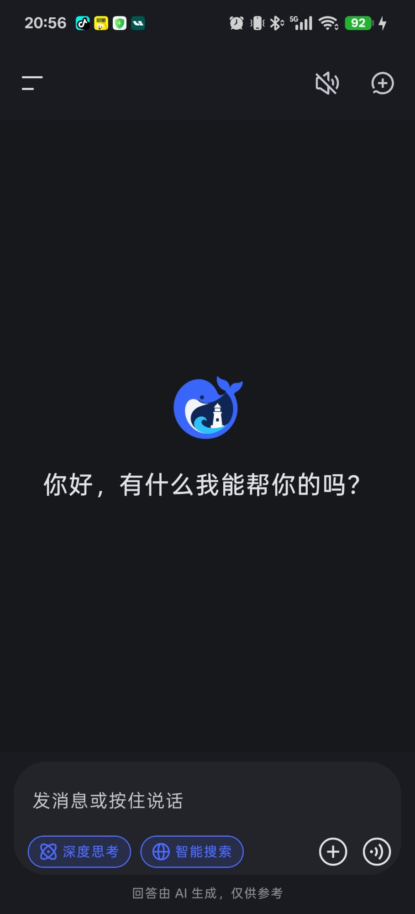
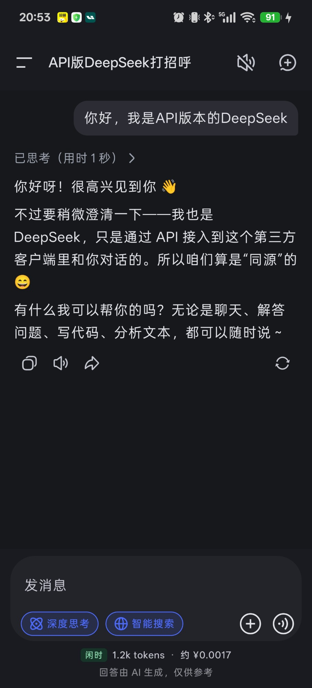
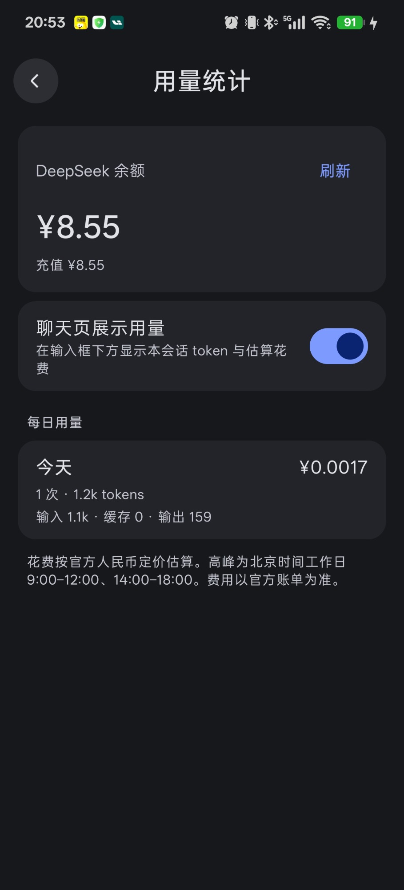

# DeepDesk

[简体中文](README.zh-CN.md)

## Download 1.2.0

- [Android APK](https://github.com/david1025/deepdesk-android/releases/download/v1.2.0/DeepDesk-1.2.0.apk) for Android 8.0 and later

[Release notes](https://github.com/david1025/deepdesk-android/releases/tag/v1.2.0)

The desktop client for Windows and macOS is [david1025/deepdesk](https://github.com/david1025/deepdesk).

DeepDesk for Android is an independent client for the DeepSeek API. It is not affiliated with DeepSeek. Enter your own API key in Settings before sending messages. Chat history stays on the device, and the key is encrypted with the Android Keystore.

The app includes streaming chat, deep thinking, web search, Markdown, photos and files, hold-to-talk input, and read-aloud. You can import and export conversation ZIP files in the chat.deepseek.com / chat-demo v3 format. The interface supports light and dark themes, and Chinese and English. There is no DeepSeek account login.

The package id is `com.david.deepdesk`. Installing this APK does not replace an older build whose id was `com.dsh.deepseek`. Later releases with the same id can update this install in place. The APK is signed with this project's release key and is not distributed through Google Play. Android may ask you to allow installation from your browser or file manager.

## Screenshots





## Build from source

You need JDK 17 or later and Android SDK 35. `local.properties` should contain `sdk.dir`.

```bash
git clone https://github.com/david1025/deepdesk-android.git
cd deepdesk-android
./gradlew :app:assembleDebug
```

The debug APK is written to `app/build/outputs/apk/debug/`. `./gradlew test` runs the unit tests.

A release APK needs `keystore/release.jks` and `keystore/release-signing.properties` (both are gitignored):

```properties
storeFile=keystore/release.jks
storePassword=******
keyAlias=dsh-release
keyPassword=******
```

```bash
./gradlew :app:assembleRelease
```

Without that keystore, the release build is signed with the debug key and is only for local checks.

## License and attribution

Third-party notices are in [LICENSES/README.md](LICENSES/README.md). Interaction ideas follow [deepseek-ai/chat-demo](https://github.com/deepseek-ai/chat-demo) (MIT). This repository does not copy that source. The launcher icon is this project's harbor mark, not the official DeepSeek whale.
