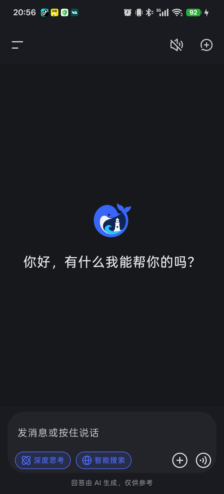
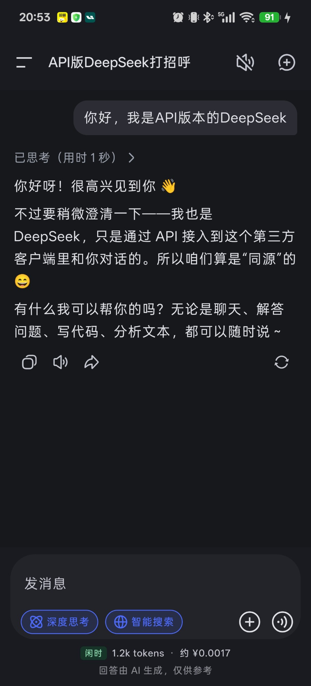
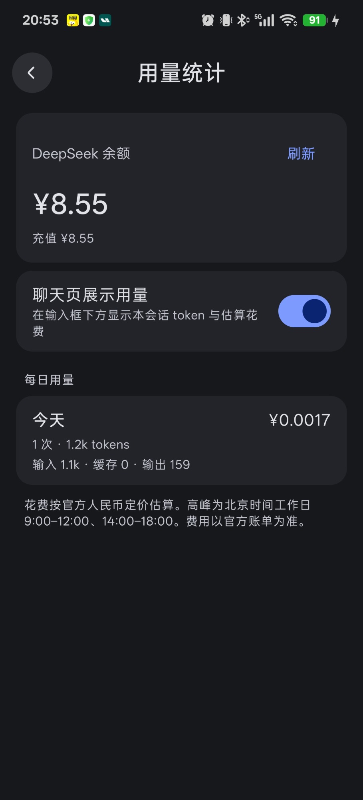

# DeepDesk

[English](README.md)

## 下载 1.2.2

- [Android 安装包（.apk）](https://github.com/david1025/deepdesk-android/releases/download/v1.2.2/DeepDesk-1.2.2.apk)，适用于 Android 8.0 及更高版本

[发布说明](https://github.com/david1025/deepdesk-android/releases/tag/v1.2.2)

Windows 和 macOS 桌面版在 [david1025/deepdesk](https://github.com/david1025/deepdesk)。

DeepDesk Android 版是独立的 DeepSeek API 客户端，与 DeepSeek 官方没有隶属关系。发送消息前，在设置里填写自己的 API Key。对话保存在本机，密钥用 Android Keystore 加密后存放。

应用支持流式对话、深度思考、联网搜索、Markdown、图片和文件、按住说话，以及朗读。可以从 chat.deepseek.com / chat-demo 的 v3 ZIP 导入对话，也可以再导出。界面支持浅色和深色、中文和英文。没有 DeepSeek 账号登录。

安装包名是 `com.david.deepdesk`。它不会覆盖以前包名为 `com.dsh.deepseek` 的旧版本。之后同一包名的发布可以在原安装上直接更新。安装包用本仓库的发布密钥签名，不经过 Google Play。系统可能会要求允许从浏览器或文件管理器安装。

## 截图





## 从源码构建

需要 JDK 17 或更高版本，以及 Android SDK 35。`local.properties` 里要有 `sdk.dir`。

```bash
git clone https://github.com/david1025/deepdesk-android.git
cd deepdesk-android
./gradlew :app:assembleDebug
```

调试包在 `app/build/outputs/apk/debug/`。`./gradlew test` 运行单元测试。

发布包需要 `keystore/release.jks` 和 `keystore/release-signing.properties`，这两项都不进版本库：

```properties
storeFile=keystore/release.jks
storePassword=******
keyAlias=dsh-release
keyPassword=******
```

```bash
./gradlew :app:assembleRelease
```

没有这套密钥时，release 会用调试密钥签名，只适合本机检查。

## 开源许可与署名

第三方许可见 [LICENSES/README.md](LICENSES/README.md)。交互参考了 [deepseek-ai/chat-demo](https://github.com/deepseek-ai/chat-demo)（MIT），本仓库没有复制它的源码。启动图标是本项目的港湾标识，不是 DeepSeek 官方鲸鱼。
